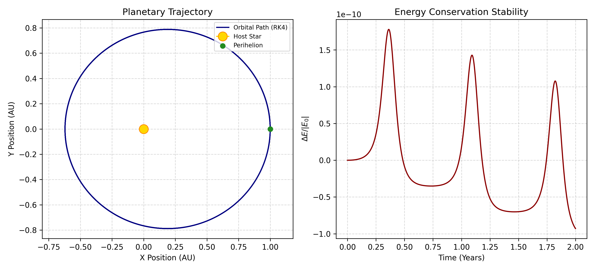

# Keplerian Orbit Simulator (Runge-Kutta 4th Order)

A Python implementation of Newtonian two-body gravitational dynamics solved using the classical 4th-Order Runge-Kutta (RK4) numerical integration algorithm.

---

## 1. Physical Formulation

The equation of motion for a planet orbiting under the gravitational field of a massive central star is governed by Newton's law of universal gravitation:

$$\frac{d^2\mathbf{r}}{dt^2} = -\frac{GM}{r^3}\mathbf{r}$$

This second-order vector differential equation is decomposed into a system of four coupled first-order ordinary differential equations (ODEs):

$$\frac{dx}{dt} = v_x, \quad \frac{dy}{dt} = v_y, \quad \frac{dv_x}{dt} = -\frac{GMx}{(x^2 + y^2)^{3/2}}, \quad \frac{dv_y}{dt} = -\frac{GMy}{(x^2 + y^2)^{3/2}}$$

The system is integrated across time using the 4th-order Runge-Kutta (RK4) algorithm with fixed time increments to ensure numerical stability and bound cumulative truncation error.

---

## 2. Simulation Results

The simulation models an elliptical orbit ($e \approx 0.25$) over 2.0 orbital periods. The right-hand panel evaluates the numerical stability of the RK4 scheme by tracking the fractional variation in specific orbital mechanical energy ($\Delta E / |E_0|$).



---

## 3. Project Structure

* `orbit_rk4.py`: Numerical integration script and phase-space visualization.
* `orbit_simulation.png`: Two-panel diagnostic plot showing the trajectory and fractional energy drift.

---

## 4. Dependencies & Execution

### Prerequisites
* Python 3.8+
* `numpy`
* `matplotlib`

### Running the Script
```bash
python orbit_rk4.py
